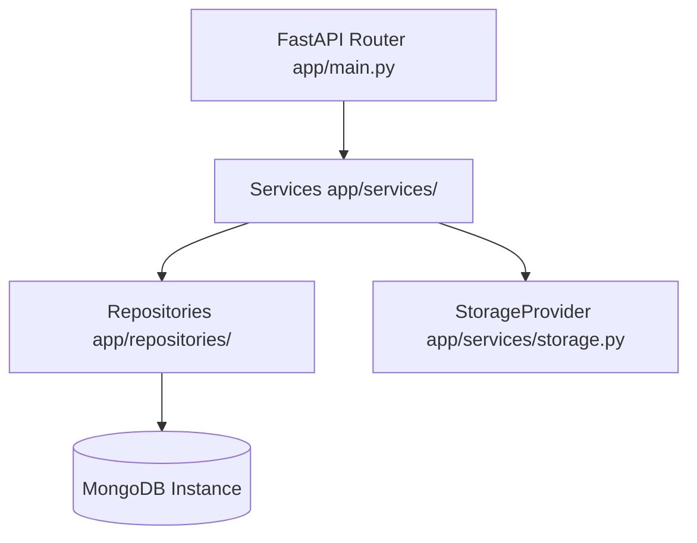

# E.M.I.T. MongoDB Reference & Administration Guide

This document is the authoritative database documentation for the E.M.I.T. (Evidence-backed Mobile Investigation Tool) platform.

MongoDB is the official primary persistence database for E.M.I.T., storing structured case parameters, parsed indicators, evidence metadata, correlation rules, threat summaries, and attack graph node/edge topologies.

---

## 1. Database Architecture & Decoupled Layers

E.M.I.T. isolates database query syntax using the **Service-Repository Pattern**:



*   **API Layer**: Validates JSON schema boundaries at incoming endpoints.
*   **Service Layer**: Governs core business rules, file SHA-256 calculation, duplicate upload rejection, and consistency rollbacks.
*   **Repository Layer**: Resolves active collections dynamically to allow runtime swaps (e.g. testing in isolated spaces).

---

## 2. Collections & Documents Schema

E.M.I.T. maintains 13 distinct MongoDB collections:

### Identifier Strategy
*   **External ID (UUID)**: All database collections use standard string-formatted UUIDs (e.g. `case_id`, `evidence_id`, `indicator_id`) to interact with the API client.
*   **Internal ID (ObjectId)**: The native MongoDB `_id` field continues to use the native `ObjectId` format but is kept internal and not exposed via API boundaries.

### Field Schemas

1.  **`cases`**:
    *   `case_id` (UUID string), `name` (string), `description` (string), `status` (OPEN, ANALYZING, COMPLETED, ARCHIVED), `created_at` (UTC datetime), `updated_at` (UTC datetime).
2.  **`evidence_files`**:
    *   `evidence_id` (UUID string), `case_id` (UUID string), `file_name` (string), `file_type` (APK, PCAP, PCAPNG), `mime_type` (string), `file_size` (int), `sha256` (string), `storage_provider` (string), `storage_path` (string), `status` (string), `uploaded_at` (UTC datetime), `created_at` (UTC datetime), `deleted_at` (Optional UTC datetime).
3.  **`apk_analyses` & `network_analyses`**:
    *   `analysis_id` (UUID string), `case_id` (UUID string), `evidence_id` (UUID string), `provider` (string, e.g. "mobsf"), `provider_version` (string), `analysis_type` (string), `status` (string), `tool_results` (raw tool dict), `normalized_summary` (normalized dict), `error` (Optional string), `started_at` (UTC datetime), `completed_at` (Optional UTC datetime), `created_at` (UTC datetime).
4.  **`indicators`**:
    *   `indicator_id` (UUID string), `case_id` (UUID string), `type` (DOMAIN, IP, URL, HASH, etc.), `value` (string), `normalized_value` (string), `metadata` (dict), `created_at` (UTC datetime), `updated_at` (UTC datetime).
5.  **`observations`**:
    *   `observation_id` (UUID string), `case_id` (UUID string), `evidence_id` (UUID string), `indicator_id` (UUID string), `observation_type` (string), `source` (string), `value` (string), `timestamp` (UTC datetime), `metadata` (dict), `created_at` (UTC datetime).
6.  **`correlations`**:
    *   `correlation_id` (UUID string), `case_id` (UUID string), `source_observation_ids` (List of UUIDs), `target_observation_ids` (List of UUIDs), `relationship_type` (string), `strength` (WEAK, MODERATE, STRONG), `reason` (string), `supporting_evidence_ids` (List of UUIDs), `created_at` (UTC datetime).
7.  **`attack_nodes`**:
    *   `node_id` (UUID string), `case_id` (UUID string), `node_type` (string), `label` (string), `entity_reference` (UUID string), `metadata` (dict), `created_at` (UTC datetime).
8.  **`attack_edges`**:
    *   `edge_id` (UUID string), `case_id` (UUID string), `source_node_id` (UUID string), `target_node_id` (UUID string), `relationship_type` (string), `relationship_class` (OBSERVED, CORRELATED, INFERRED), `strength` (string), `reason` (string), `supporting_observation_ids` (List of UUIDs), `supporting_correlation_ids` (List of UUIDs), `supporting_evidence_ids` (List of UUIDs), `created_at` (UTC datetime).
9.  **`threat_intelligence`**:
    *   `threat_intel_id` (UUID string), `case_id` (UUID string), `indicator_id` (UUID string), `provider` (string), `verdict` (string), `score` (Optional float), `categories` (List of strings), `raw_result` (dict), `checked_at` (UTC datetime), `expires_at` (UTC datetime), `created_at` (UTC datetime).
10. **`risk_assessments`**:
    *   `risk_assessment_id` (UUID string), `case_id` (UUID string), `risk_level` (LOW, MEDIUM, HIGH, CRITICAL), `confidence` (float), `summary` (string), `supporting_observation_ids` (List of UUIDs), `supporting_correlation_ids` (List of UUIDs), `supporting_evidence_ids` (List of UUIDs), `limitations` (List of strings), `created_at` (UTC datetime), `updated_at` (UTC datetime).
11. **`reports`**:
    *   `report_id` (UUID string), `case_id` (UUID string), `report_type` (string), `storage_path` (string), `status` (PENDING, GENERATING, COMPLETED, FAILED), `generated_at` (Optional UTC datetime), `created_at` (UTC datetime).
12. **`analysis_runs`**:
    *   `analysis_id` (UUID string), `case_id` (UUID string), `evidence_id` (UUID string), `analysis_type` (APK, PCAP), `status` (PENDING, COMPLETED, PARTIAL, FAILED), `started_at` (UTC datetime), `completed_at` (Optional UTC datetime), `current_stage` (PENDING, VALIDATING, ANALYZING, NORMALIZING, COMPLETED, FAILED), `provider_results` (Dict mapping provider name to `ProviderExecutionRecord`), `errors` (List of strings), `warnings` (List of strings), `created_at` (UTC datetime), `updated_at` (UTC datetime).


---

## 3. Index Layout & Optimization Reasoning

All index setups are run idempotently via `scripts/init_mongodb.py`:

*   **Cases**:
    *   `case_id` (Unique Index) — Guarantees system-wide uniqueness and rapid fetching of Case metadata.
    *   `status`, `created_at` (Standard Indexes) — Supports sorting and filtering in Dashboard list views.
*   **Evidence Files**:
    *   `evidence_id` (Unique Index).
    *   `case_id` (Standard Index) — Isolates evidence list queries.
    *   `sha256` (Standard Index) — Speeds up cross-case hash queries.
    *   `case_id + sha256` (Unique Compound Index) — Guarantees that the exact same evidence binary cannot be uploaded twice to the same investigation case.
*   **Indicators**:
    *   `indicator_id` (Unique Index).
    *   `case_id` (Standard Index).
    *   `type`, `normalized_value` (Standard Indexes) — Optimizes search queries for indicators.
    *   `case_id + type + normalized_value` (Unique Compound Index) — Prevents duplicate indicators from bloating case analytics.
*   **Observations, Correlations, Attack Graphs**:
    *   Uses unique identifiers and links case-isolation constraints via `case_id` indexes to prevent leakages across parallel investigations.
*   **Analysis Runs**:
    *   `analysis_id` (Unique Index).
    *   `case_id` (Standard Index) — Speeds up case analysis dashboard listings.
    *   `evidence_id` (Standard Index) — Facilitates rapid status tracing for specific files.
    *   `created_at`, `status` (Standard Indexes) — Accelerates filtering of pending or failed runs.


---

## 4. Storage Strategy: Dev vs. Production

Binary evidence files (large APK and PCAP packages) are never placed directly inside normal MongoDB documents to avoid driver throttling and BSON size threshold overflows (16MB).

*   **Development Storage**: Uses `LocalStorageProvider` mapping uploads to `backend/storage/`. Files are sanitized using `os.path.basename` to prevent path traversal attempts, and checks are run to ensure file operations do not escape base directory boundaries.
*   **Production Storage**: Must swap out `LocalStorageProvider` for a cloud object store provider (e.g. S3, Azure Blob, or GridFSStorageProvider) by inheriting from `StorageProvider` and updating settings without changing the underlying FastAPI routers or services.

---

## 5. Environment Variables & Setup Configurations

Ensure your `backend/.env` is configured with the following settings (refer to `backend/.env.example` as a template):

```env
MONGODB_URI=mongodb://localhost:27017
MONGODB_DATABASE=emit
```

### MongoDB Atlas Configuration

#### Development Configuration
*   **Network Security**: You can add your current IP address to the Atlas Network access tab. While `0.0.0.0/0` is acceptable for local development and testing speed, it exposes the Atlas cluster port to the public web.
*   **Scale**: M0 Free Tier shared cluster is sufficient for local development.

#### Production Configuration
*   **Network Security**: Never configure `0.0.0.0/0` (Allow Access From Anywhere) in production. Restrict cluster IP access solely to the specific server or VPC hosting the FastAPI backend application.
*   **Authentication**: Create separate Atlas database users with minimal read/write policies (least privilege).
*   **Encryption**: Ensure TLS/SSL connection parameters are appended to the MongoDB connection string.

---

## 6. Database Initialization

Run the initialization script to establish collections and indexes:

```powershell
python scripts/init_mongodb.py
```

*   **Idempotency**: Running the script multiple times is safe and will not affect existing investigation data or cause duplicate indexes.
*   **Failure Behavior**: The script will exit with a non-zero exit code if connection parameters are invalid or if a network failure prevents contacting the host database server.

---

## 7. Backup Considerations

Since E.M.I.T. uses a split-storage model (MongoDB for metadata + StorageProvider for files), backups must be coordinated to ensure consistency:

*   **Database backups**: Run standard MongoDB dumps:
    ```powershell
    mongodump --uri="your_mongodb_uri" --db=emit --out=/backups/db/
    ```
*   **Binary storage backups**: Back up files saved in your storage provider. If local, run file system archives (e.g. zip/rsync).
*   **Restoration rule**: Always restore binary storage first and then restore MongoDB collections to prevent database indicators pointing to missing files.
