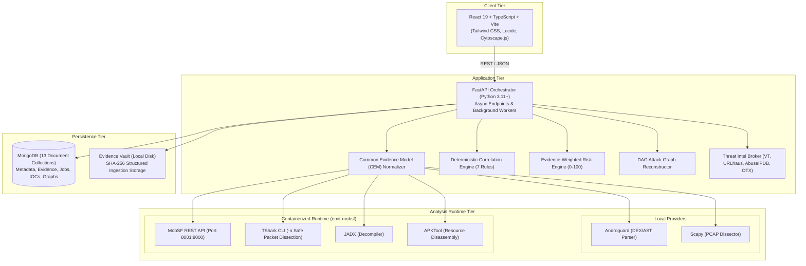
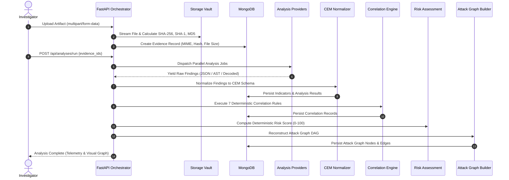

# System Architecture & Technical Design

This document details the architectural design, evidence processing pipeline, data models, and component boundaries of **E.M.I.T.** (Evidence-backed Mobile Investigation Tool).

---

## 1. System Overview & Design Principles

E.M.I.T. is an evidence-first digital forensics and incident response (DFIR) platform designed to bridge the gap between static mobile package analysis (Android APKs) and dynamic network captures (PCAP/PCAPNG). 

### Architectural Tenets
1. **Deterministic Forensics**: Every correlation, indicator, and risk score is strictly traceable to raw evidence artifacts and rule criteria. The platform uses zero black-box machine learning.
2. **Fact vs. Inference Separation**: Graph edges and correlation events strictly separate direct observations (e.g., a byte sequence or packet stream) from deductive inferences (e.g., C2 suspicion or malicious intent).
3. **Provider Isolation**: Heavyweight analysis tools (MobSF, TShark, JADX, APKTool) execute within isolated containerized environments or sandboxed subprocesses to safeguard host integrity.
4. **Common Evidence Model (CEM)**: Heterogeneous output schemas from disparate analysis tools are normalized into uniform, typed structures prior to correlation.

---

## 2. Component Topology

The system comprises three primary execution tiers:



### Network Topology & Port Allocations
| Service | Default Port | Protocol | Binding | Purpose |
| :--- | :--- | :--- | :--- | :--- |
| **Frontend UI** | `5173` | HTTP | `localhost` | Vite development server / Web UI |
| **FastAPI Backend** | `8000` | HTTP | `127.0.0.1` | REST API, orchestration, report generation |
| **MobSF Analysis Container** | `8001` (host) &rarr; `8000` (container) | HTTP | `127.0.0.1` | Static APK security engine |
| **MongoDB** | `27017` | TCP | `127.0.0.1` | Persistent forensic data storage |

---

## 3. Analysis Pipeline & Common Evidence Model (CEM)

When an evidence item (APK or PCAP) is ingested, it traverses an 8-stage pipeline:



### Common Evidence Model (CEM) Schemas

Disparate tools generate fragmented output formats (e.g., MobSF JSON, Androguard class representations, TShark frame arrays). CEM unifies these into structured models:

```typescript
// Conceptual CEM Representation
interface CEMNormalizedResult {
  evidence_id: string;
  provider: "androguard" | "mobsf" | "jadx" | "apktool" | "scapy" | "tshark";
  target_type: "APK" | "PCAP";
  execution_time_ms: number;
  indicators: Array<{
    type: "IP" | "DOMAIN" | "HASH" | "URL" | "EMAIL";
    value: string;
    confidence: number;
    context: string; // e.g., "classes.dex string", "DNS Query Request", "AndroidManifest.xml"
  }>;
  capabilities: Array<{
    category: string; // e.g., "TELEPHONY", "CAMERA", "DYNAMIC_LOADING", "ROOT_DETECTION"
    identifier: string;
    description: string;
    evidence_offset?: string;
  }>;
  network_conversations?: Array<{
    src_ip: string;
    src_port: number;
    dst_ip: string;
    dst_port: number;
    protocol: string;
    sni?: string;
    dns_query?: string;
    bytes_transferred: number;
    timestamp_epoch: number;
  }>;
}
```

---

## 4. Database Schema & Collections

E.M.I.T. stores forensic artifacts and state across 13 MongoDB collections:

| Collection | Schema Description & Key Indexes |
| :--- | :--- |
| `cases` | Case metadata, investigator identity, case tags, operational status. Indexed on `case_id` (unique), `status`, `created_at`. |
| `evidence_files` | Cryptographic hashes (SHA-256, SHA-1, MD5), file size, MIME type, original filename, storage location. Indexed on `evidence_id` (unique), `case_id`, `sha256`, compound `(case_id, sha256)`. |
| `apk_analyses` | Static APK findings, permissions, exported components, certificate metadata, extracted strings. Indexed on `analysis_id` (unique), `case_id`, `evidence_id`, `status`. |
| `network_analyses` | PCAP packet analysis, IP conversations, DNS transactions, HTTP requests, beacon intervals. Indexed on `analysis_id` (unique), `case_id`, `evidence_id`, `status`. |
| `indicators` | De-duplicated indicators of compromise (IOCs), categorization, verification status. Indexed on `indicator_id` (unique), compound `(case_id, type, normalized_value)`. |
| `observations` | Atomic empirical occurrences linking evidence files to indicators with exact offsets/timestamps. Indexed on `observation_id` (unique), `case_id`, `evidence_id`, `indicator_id`. |
| `correlations` | Deterministic cross-evidence links, rule IDs (Rule 1–7), confidence scores, supporting facts. Indexed on `correlation_id` (unique), `case_id`, `relationship_type`. |
| `attack_nodes` | Graph nodes representing entities (`APPLICATION`, `DOMAIN`, `IP`, `CAPABILITY`, `EVENT`, `THREAT_INTEL`). Indexed on `node_id` (unique), `case_id`, `node_type`. |
| `attack_edges` | Graph directed edges with explicit provenance classes (`OBSERVED`, `CORRELATED`, `INFERRED`). Indexed on `edge_id` (unique), `case_id`, `source_node_id`, `target_node_id`. |
| `threat_intelligence` | Case-specific threat intelligence responses with engine detection ratios, threat classifications, and attribution. Indexed on `threat_intel_id` (unique), `case_id`, `indicator_id`. |
| `risk_assessments` | Computed case risk scores (0–100), categorical level (`LOW`, `MEDIUM`, `HIGH`, `CRITICAL`), factor weight breakdowns. Indexed on `risk_assessment_id` (unique), `case_id`. |
| `reports` | Compiled investigation dossiers, executive summaries, export artifact manifests (HTML, PDF, JSON, CSV). Indexed on `report_id` (unique), `case_id`, `status`. |
| `analysis_runs` | Job execution tracker, provider status, execution timing, logs, error states. Indexed on `analysis_id` (unique), `case_id`, `evidence_id`, `status`. |

---

## 5. Directed Acyclic Graph (DAG) Model

The attack chain reconstruction synthesizes static findings and network captures into an interactive Directed Acyclic Graph:

### Node Types
- `APPLICATION`: The target APK, package name, signing certificate thumbprint.
- `DOMAIN`: Hostnames resolved via DNS or identified in APK string pools.
- `IP`: Network egress endpoints extracted from packet streams or socket calls.
- `CAPABILITY`: Android permissions, suspicious API usages (e.g., reflection, dynamic code loading).
- `EVENT`: Temporal milestones (e.g., application installation, initial beaconing, permission escalation).
- `THREAT_INTEL`: Threat classifications, malware family attributions, external reputation flags.

### Edge Types & Epistemic Classes
Every edge in the attack graph is assigned an evidentiary classification:
- **`OBSERVED`** (Solid Edge): Directly recorded in empirical evidence. Examples:
  - APK manifest requests permission `android.permission.RECORD_AUDIO`.
  - Frame 412 in PCAP contains TCP SYN to `198.51.100.24:443`.
- **`CORRELATED`** (Dashed Edge): Synthesized through deterministic rule matching across multiple sources. Example:
  - Domain `telemetry-sync.net` identified in APK strings matches the destination of an HTTP POST in PCAP.
- **`INFERRED`** (Dotted Edge): Deductive hypothesis based on risk scoring and threat intelligence. Example:
  - IP `203.0.113.5` linked as C2 Command & Control node due to high AbuseIPDB score and beaconing behavior.

---

## 6. Threat Intel Broker & Isolation

To protect investigator anonymity and prevent infrastructure contamination:
- External queries are proxied solely through the server-side FastAPI application; the client browser never queries external threat intelligence APIs directly.
- All lookups are cached locally in MongoDB (`threat_intel_cache`) with a configurable 24-hour TTL, mitigating rate-limiting and preventing repetitive reconnaissance queries.
- TShark packet dissection strictly operates with `-n` (disabling live reverse DNS lookups) to eliminate accidental DNS leakages to attacker-controlled authoritative nameservers.
