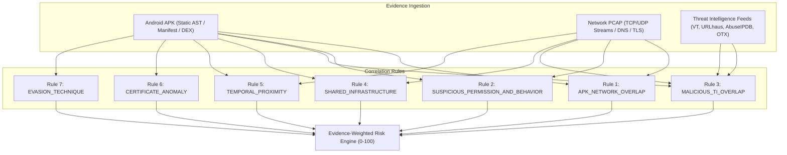

# Deterministic Correlation Rules & Risk Engine Reference

This document provides a technical specification of the **7 Deterministic Correlation Rules** and the **Evidence-Weighted Risk Assessment Engine** implemented in E.M.I.T.

---

## 1. Design Philosophy: Determinism Over Speculation

Digital forensics requires evidentiary integrity and legal defensibility. Heuristic or non-deterministic machine-learning models frequently produce variable outputs, cannot be cross-examined mathematically, and are prone to hallucinations.

E.M.I.T. implements **100% deterministic correlation**:
- Every correlation fires strictly when explicit programmatic conditions are satisfied across multiple evidence sources.
- Every score contribution is backed by recorded facts and rule weights.
- Findings distinguish between direct **observations**, cross-source **correlations**, and risk **inferences**.

---

## 2. The 7 Deterministic Correlation Rules

---

### Rule 1: APK_NETWORK_OVERLAP
- **Rule ID**: `R1_APK_NET_OVERLAP`
- **Category**: Cross-Evidence Convergence
- **Evidentiary Strength**: `CORRELATED` (Edge: Dashed)
- **Base Confidence**: 0.90
- **Risk Score Impact**: +25

#### Input Criteria
1. An APK artifact analyzed via static providers (Androguard, MobSF, JADX) yields extracted domain strings, URLs, or hardcoded IP addresses.
2. A PCAP/PCAPNG network capture associated with the same investigation case yields observed network destinations (DNS queries, TLS Server Name Indication [SNI], HTTP Host headers, or destination IP addresses).
3. The string value or resolved IP of the APK finding matches the PCAP communication destination.

#### False Positive Mitigation
- Default inclusion filters suppress common operating system CDNs, Android platform endpoints (e.g., `android.com`, `googleapis.com`, `connectivitycheck.gstatic.com`), and common public NTP/DNS infrastructure unless anomalous payloads or non-standard ports are detected.

#### Scenario Example
Static analysis of `bank_update.apk` extracts a hardcoded endpoint `api.legit-financial-portal.cc`. PCAP packet dissection identifies periodic TLS handshakes to that domain from the mobile device IP within minutes of APK installation.

---

### Rule 2: SUSPICIOUS_PERMISSION_AND_BEHAVIOR
- **Rule ID**: `R2_SUSPICIOUS_PERM_BEHAVIOR`
- **Category**: Behavioral Congruence
- **Evidentiary Strength**: `CORRELATED` (Edge: Dashed)
- **Base Confidence**: 0.85
- **Risk Score Impact**: +20

#### Input Criteria
1. Static analysis reveals declared "Dangerous" or "Special" Android permissions:
   - Audio/Video: `RECORD_AUDIO`, `CAMERA`
   - Exfiltration/Telephony: `READ_CONTACTS`, `READ_SMS`, `SEND_SMS`, `READ_CALL_LOG`
   - Location: `ACCESS_FINE_LOCATION`, `ACCESS_BACKGROUND_LOCATION`
2. Corroborating network or service events are recorded:
   - High-frequency egress data bursts to external servers.
   - Background service persistence declarations without foreground notification channels.
   - Network transmission immediately following permission-gated system intent triggers.

#### Scenario Example
An application requesting `READ_SMS` and `RECORD_AUDIO` exhibits recurring outbound HTTP POST requests transmitting binary-encoded payloads to an unverified foreign IP.

---

### Rule 3: MALICIOUS_TI_OVERLAP
- **Rule ID**: `R3_MALICIOUS_TI_OVERLAP`
- **Category**: External Intelligence Validation
- **Evidentiary Strength**: `INFERRED` (Edge: Dotted)
- **Base Confidence**: 0.95
- **Risk Score Impact**: +30

#### Input Criteria
1. An extracted IOC (file SHA-256 hash, domain name, destination IP, or URL) is queried against threat intelligence providers (VirusTotal, URLhaus, AbuseIPDB, AlienVault OTX).
2. The provider response exceeds predefined malicious thresholds:
   - VirusTotal: &ge; 3 positive security vendor detections.
   - AbuseIPDB: Confidence of abuse &ge; 25%.
   - URLhaus: Listed as active malware distribution or C2 endpoint.
   - OTX: Associated with known threat adversary pulses or indicators.

#### Scenario Example
A destination IP recorded in PCAP traffic matches an active URLhaus entry flagged for delivering the `Hydra` mobile banking trojan.

---

### Rule 4: SHARED_INFRASTRUCTURE
- **Rule ID**: `R4_SHARED_INFRASTRUCTURE`
- **Category**: Campaign / Actor Correlation
- **Evidentiary Strength**: `CORRELATED` (Edge: Dashed)
- **Base Confidence**: 0.80
- **Risk Score Impact**: +15

#### Input Criteria
1. Multiple evidence artifacts within the same case (or across linked cases) communicate with identical remote infrastructure (shared C2 IP subnet, shared nameserver, or identical TLS certificate serial).
2. The infrastructure is not an enterprise public cloud CDN or ubiquitous service provider.

#### Scenario Example
Two distinct APK packages discovered on separate seized devices both transmit registration beacons to the same /28 IP block utilizing identical TLS certificate fingerprints.

---

### Rule 5: TEMPORAL_PROXIMITY
- **Rule ID**: `R5_TEMPORAL_PROXIMITY`
- **Category**: Chronological Sequence
- **Evidentiary Strength**: `CORRELATED` (Edge: Dashed)
- **Base Confidence**: 0.75
- **Risk Score Impact**: +15

#### Input Criteria
1. A significant application lifecycle event occurs (e.g., package installation time, `BOOT_COMPLETED` broadcast receiver trigger, or dynamic DEX load).
2. Outbound network activity, DNS lookups, or high-volume data egress occur within a tight temporal window (&Delta;t &le; 60 seconds) of that event.

#### Scenario Example
Immediately upon the execution of a dropper application's background service (timestamp $T_0$), a spike in DNS queries for dynamic DNS hostnames occurs at $T_0 + 4\text{s}$.

---

### Rule 6: CERTIFICATE_ANOMALY
- **Rule ID**: `R6_CERTIFICATE_ANOMALY`
- **Category**: Cryptographic Integrity
- **Evidentiary Strength**: `OBSERVED` (Edge: Solid)
- **Base Confidence**: 0.85
- **Risk Score Impact**: +10

#### Input Criteria
1. The APK signing certificate exhibits one or more forensic anomalies:
   - Self-signed certificate using default generic strings (e.g., `CN=Android Debug`, `O=Android`, `C=US`).
   - Validity dates extending beyond realistic standards (&gt; 50 years or starting in the future).
   - Insecure signing algorithms (e.g., MD5withRSA or SHA1withRSA without secondary SHA-256 signatures).
   - Known public test-key certificates widely distributed in open-source malware frameworks.

#### Scenario Example
An alleged enterprise banking application is packaged and distributed signed with default Android debug keys (`Android Debug, Android, US`).

---

### Rule 7: EVASION_TECHNIQUE
- **Rule ID**: `R7_EVASION_TECHNIQUE`
- **Category**: Anti-Analysis Detection
- **Evidentiary Strength**: `OBSERVED` (Edge: Solid)
- **Base Confidence**: 0.90
- **Risk Score Impact**: +20

#### Input Criteria
1. Static disassembly (Androguard, JADX, APKTool) identifies anti-analysis capabilities:
   - **Root Detection**: Verification of `su` binary, checking `/system/app/Superuser.apk`, executing `which su`.
   - **Emulator Checks**: Reading system properties (`ro.kernel.qemu`, `ro.hardware=goldfish`), checking build board models.
   - **Dynamic Code Loading**: Direct invocations of `dalvik.system.DexClassLoader`, `InMemoryDexClassLoader`, or `PathClassLoader`.
   - **Obfuscation / Native Reflection**: Heavy use of reflection (`java.lang.reflect.Method`) paired with encrypted byte arrays or packed native ELF shared objects (`.so`).

#### Scenario Example
The APK contains string references to known emulator drivers (`goldfish`, `qemu`) and dynamically downloads an encrypted `.dex` file from a remote server, decrypting it into memory via `InMemoryDexClassLoader`.

---

## 3. Evidence-Weighted Risk Scoring Engine

The risk assessment engine calculates a single case-level risk score between **0 and 100**, categorized into four operational threat tiers:

| Score Range | Threat Tier | Investigative Action |
| :--- | :--- | :--- |
| **0 – 25** | `LOW` | Benign or low-capability application. Minimal anomaly indicators. |
| **26 – 50** | `MEDIUM` | Elevated privileges or anomalous networking; requires manual analyst verification. |
| **51 – 75** | `HIGH` | Verified C2 infrastructure, suspicious permissions, or evasion routines confirmed. |
| **76 – 100** | `CRITICAL` | Confirmed malicious behavior, high threat intel consensus, active credential or data theft. |

---

### Mathematical Formula

The case risk score $S$ is computed using a deterministic weighted summation bounded to $[0, 100]$:

$$S = \min\left(100, \left\lfloor \sum_{i \in \text{Rules}} (W_i \cdot C_i) + \sum_{j \in \text{TI}} M_j + \sum_{k \in \text{Caps}} V_k \right\rfloor\right)$$

Where:
- $W_i$ is the base risk impact of Rule $i$.
- $C_i$ is the calculated rule confidence multiplier ($0.0 \le C_i \le 1.0$).
- $M_j$ is the threat intelligence modifier for external IOC detection $j$ ($+5$ to $+20$ based on engine consensus).
- $V_k$ is the baseline severity of critical APK capabilities (e.g., Dynamic DEX loading $+15$, Audio Recording $+10$).

#### Deductive vs. Empirical Weighting
- Observed facts (such as direct file hashes matching known malware or explicit cryptographic debug keys) provide immediate deterministic baselines.
- Inferred edges and single-source matches are subject to strict dampening factors to prevent inflated risk scores from benign high-permission applications.
