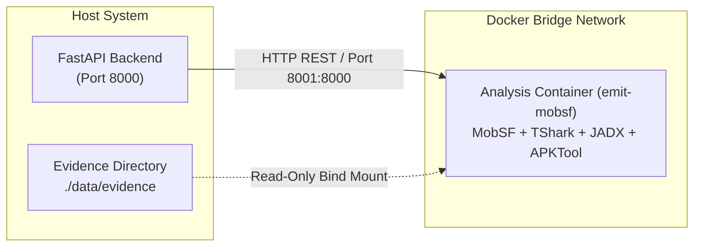

# Deployment & Production Operations Guide

This guide covers deployment architectures, container orchestration, database setup, environment configuration, reverse proxy setup, and operational hardening for **E.M.I.T.**.

---

## 1. Prerequisites & System Requirements

### Hardware Recommendations
- **CPU**: 4+ physical cores (recommended for parallel DEX decompilation and packet stream reassembly).
- **Memory**: Minimum 8 GB RAM (16 GB recommended when running MobSF and large PCAP analyses).
- **Storage**: Minimum 50 GB free NVMe/SSD space for MongoDB database, evidence storage, and decompiler caches.

### Software Dependencies
- **Operating System**: Linux (Ubuntu 22.04 LTS / Debian 12 / RHEL 9) or Windows 10/11 with WSL2 / Docker Desktop.
- **Python**: 3.11 or higher.
- **Node.js**: 20.x LTS or higher (with `npm` or `pnpm`).
- **Docker & Docker Compose**: Docker Engine 24.0+ with Compose V2.
- **MongoDB**: Community or Enterprise Server 6.0+ (or containerized MongoDB).

---

## 2. Docker Architecture & Analysis Runtime

E.M.I.T. executes heavyweight, potentially untrusted forensic workloads inside an isolated Docker container built from `Dockerfile.analysis`.



### Docker Compose Configuration
The repository includes a production-ready `docker-compose.yml`:

```yaml
version: '3.8'

services:
  mobsf:
    build:
      context: .
      dockerfile: Dockerfile.analysis
    image: emit-mobsf:latest
    container_name: emit-mobsf
    restart: unless-stopped
    ports:
      # Host 8001 mapped to Container 8000 to prevent port conflict with FastAPI (8000)
      - "127.0.0.1:8001:8000"
    environment:
      - MOBSF_API_KEY=${MOBSF_API_KEY:-emit_mobsf_api_key_secret}
    volumes:
      - mobsf_data:/root/.MobSF
      - ./data/evidence:/data/evidence:ro
    networks:
      - emit-net

networks:
  emit-net:
    driver: bridge

volumes:
  mobsf_data:
```

### Building and Starting the Analysis Runtime
```bash
# Build the analysis container image
docker compose build

# Start the container in detached mode
docker compose up -d

# Verify container status
docker compose ps
```

---

## 3. Environment Configuration

Copy `.env.example` to `.env` in the `backend/` directory and configure the variables:

| Variable | Default Value | Description |
| :--- | :--- | :--- |
| `HOST` | `127.0.0.1` | IP address for FastAPI server binding. |
| `PORT` | `8000` | Port for FastAPI backend service. |
| `MONGODB_URI` | `mongodb://localhost:27017` | MongoDB connection connection URI string. |
| `MONGODB_DATABASE` | `emit` | Primary database name for operational records. |
| `MONGODB_TEST_URI` | `mongodb://localhost:27017` | MongoDB URI used when running automated test suite. |
| `MONGODB_TEST_DATABASE` | `emit_test` | Isolated database instance used during test execution. |
| `CORS_ORIGINS` | `http://localhost:5173,http://127.0.0.1:5173` | Allowed CORS origins for browser security policy. |
| `MOBSF_URL` | `http://localhost:8001` | URL for MobSF REST API. |
| `MOBSF_API_KEY` | `emit_mobsf_api_key_secret` | Shared secret key for authenticating with MobSF. |
| `ENABLE_PROVIDER_MOBSF` | `true` | Enable/disable containerized MobSF analysis. |
| `ENABLE_PROVIDER_ANDROGUARD` | `true` | Enable/disable native Androguard static parser. |
| `ENABLE_PROVIDER_JADX` | `true` | Enable/disable JADX Java decompiler. |
| `ENABLE_PROVIDER_APKTOOL` | `true` | Enable/disable APKTool resource disassembler. |
| `ENABLE_PROVIDER_TSHARK` | `true` | Enable/disable TShark packet dissector. |
| `ENABLE_PROVIDER_SCAPY` | `true` | Enable/disable Scapy native packet dissector. |
| `VIRUSTOTAL_API_KEY` | *(optional)* | API key for VirusTotal reputation lookups. |
| `URLHAUS_API_KEY` | *(optional)* | API key for URLhaus threat intelligence. |
| `ABUSEIPDB_API_KEY` | *(optional)* | API key for AbuseIPDB IP reputation queries. |
| `OTX_API_KEY` | *(optional)* | API key for AlienVault OTX pulses. |
| `THREAT_INTEL_CACHE_HOURS`| `24` | Local TTL cache duration for threat intelligence lookups. |
| `MAX_EVIDENCE_SIZE_BYTES`| `524288000` | Maximum artifact upload size (500 MB). |
| `ANALYSIS_TIMEOUT_SECONDS`| `180` | Per-provider execution timeout in seconds. |

> [!NOTE]
> Environment variable names must use `MONGODB_URI` and `MONGODB_DATABASE`. Legacy references to `MONGO_URI` or `MONGO_DB_NAME` are not recognized by the backend settings loader.

---

## 4. Database Setup & Index Initialization

E.M.I.T. requires specific compound and unique indexes in MongoDB to guarantee query performance across graph nodes, IOCs, and hash lookups.

Initialize the collections and indexes with the database management module:

```bash
# From within the backend directory with virtual environment activated:
cd backend
python scripts/init_mongodb.py
```

This creates the 13 collections, enforces unique constraints (such as `sha256` in evidence and unique indicator values per case), and creates TTL indexes for `threat_intel_cache`.

---

## 5. Reverse Proxy Setup (Nginx)

In production environments, E.M.I.T. should be served behind a reverse proxy handling SSL termination and payload size configuration.

### Sample Nginx Configuration (`/etc/nginx/sites-available/emit.conf`)
```nginx
server {
    listen 80;
    server_name emit.investigation.local;
    return 301 https://$host$request_uri;
}

server {
    listen 443 ssl http2;
    server_name emit.investigation.local;

    ssl_certificate /etc/ssl/certs/emit.crt;
    ssl_certificate_key /etc/ssl/private/emit.key;
    ssl_protocols TLSv1.2 TLSv1.3;
    ssl_ciphers HIGH:!aNULL:!MD5;

    # Maximum forensic artifact upload size (must match MAX_EVIDENCE_SIZE_BYTES)
    client_max_body_size 500M;
    client_body_buffer_size 128k;

    # Frontend Single Page Application
    location / {
        root /var/www/emit/frontend/dist;
        index index.html;
        try_files $uri $uri/ /index.html;
    }

    # Backend API Endpoints
    location /api/ {
        proxy_pass http://127.0.0.1:8000;
        proxy_http_version 1.1;
        proxy_set_header Upgrade $http_upgrade;
        proxy_set_header Connection 'upgrade';
        proxy_set_header Host $host;
        proxy_set_header X-Real-IP $remote_addr;
        proxy_set_header X-Forwarded-For $proxy_add_x_forwarded_for;
        proxy_set_header X-Forwarded-Proto $scheme;

        # Timeouts for lengthy decompilation or packet reassembly tasks
        proxy_connect_timeout 300s;
        proxy_send_timeout 300s;
        proxy_read_timeout 300s;
    }

    # Health Check Endpoint
    location /health {
        proxy_pass http://127.0.0.1:8000/health;
        proxy_set_header Host $host;
    }
}
```

---

## 6. Security Hardening & Isolation

1. **DNS Leak Prevention (`-n` Flag)**:
   When analyzing untrusted PCAP files, TShark is executed with the `-n` parameter to disable network name resolution. This prevents the host system from issuing real DNS queries for malicious domains observed in captured traffic.

2. **Network Segmentation**:
   The Docker container running MobSF and TShark should have outbound internet connectivity restricted if air-gapped forensic policy requires it. Threat intelligence queries originate solely from the FastAPI host layer.

3. **Read-Only Evidence Mounts**:
   Evidence files mounted into analysis containers are mounted with `:ro` (read-only) flags to prevent accidental modification or tampering of raw evidence.

4. **Cryptographic Validation**:
   Upon ingestion, files are hashed immediately with SHA-256, SHA-1, and MD5. All subsequent pipeline stages reference files by SHA-256 to ensure chain of custody.

---

## 7. Operations & Health Verification

### Health Check
```bash
curl -s http://127.0.0.1:8000/health | jq .
```

Expected output:
```json
{
  "status": "healthy",
  "database": {
    "connected": true,
    "database": "emit"
  }
}
```

### Database Backup
```bash
# Dump operational database
mongodump --uri="mongodb://localhost:27017/emit" --out=/var/backups/emit-$(date +%F)

# Restore operational database
mongorestore --uri="mongodb://localhost:27017/emit" /var/backups/emit-YYYY-MM-DD/emit
```
