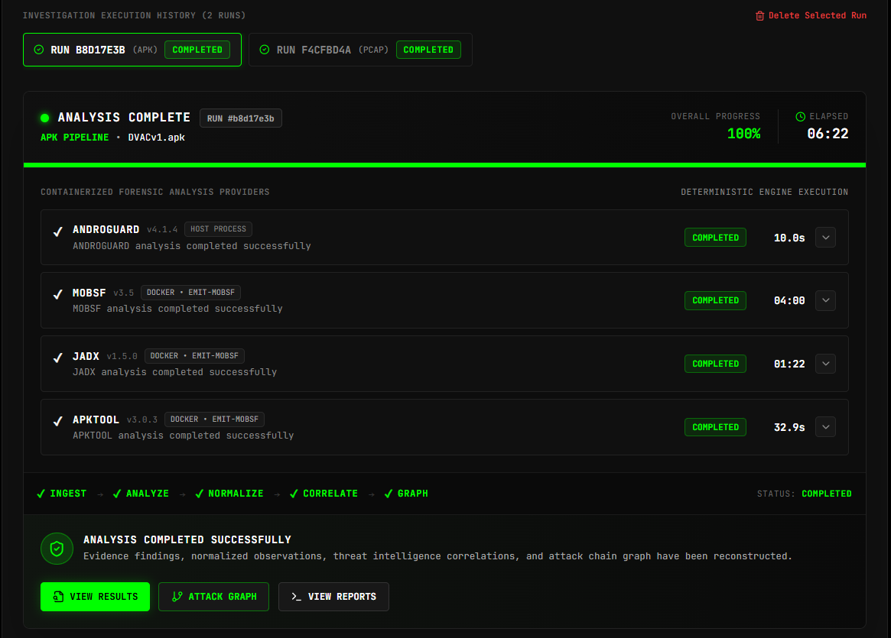
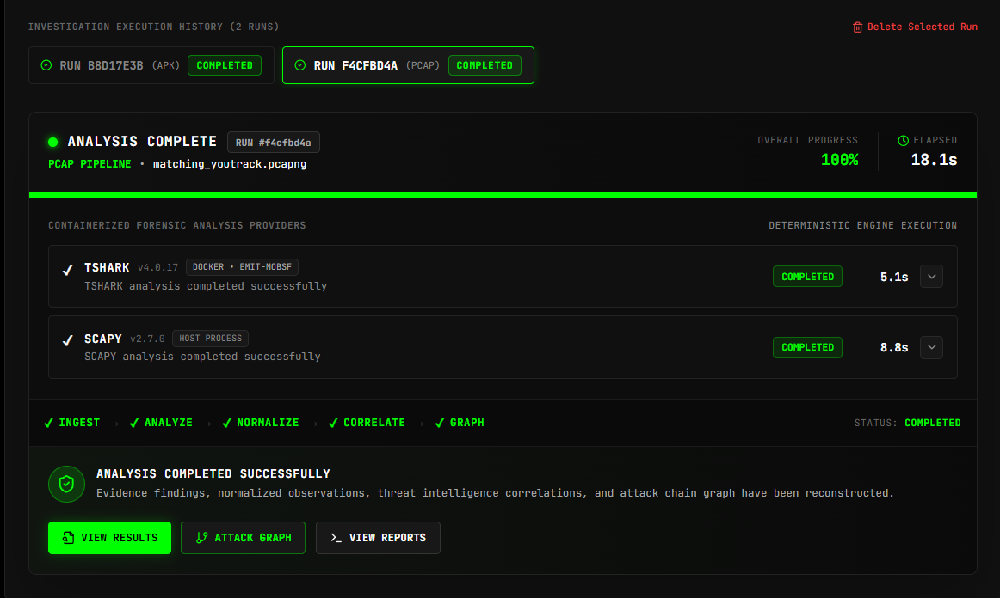
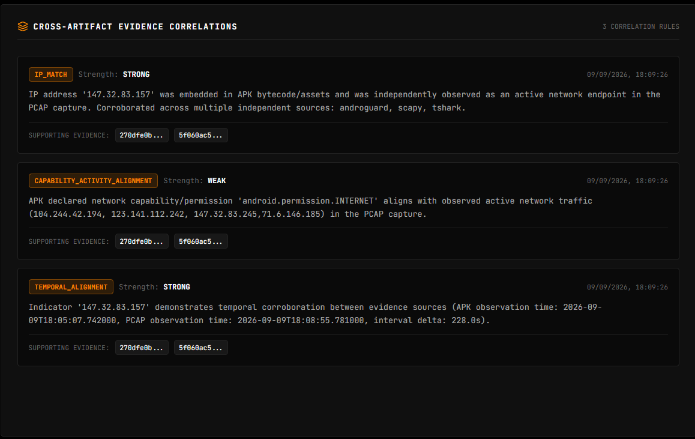
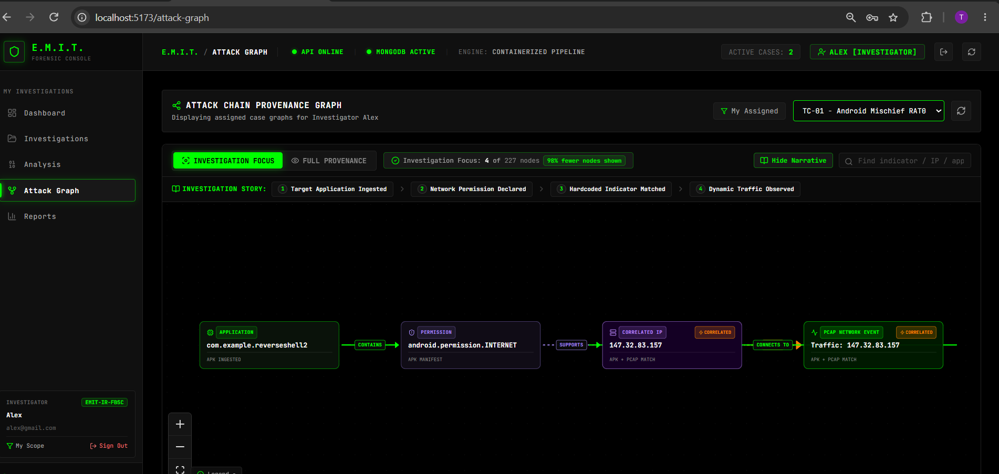

# TC-01 — Android Mischief RAT08

## 1. Test Case Overview

**Test Case:** TC-01  
**Case Name:** Android Mischief RAT08  
**Objective:** Validate E.M.I.T.'s ability to perform end-to-end forensic analysis of an Android APK and a network capture, correlate evidence across both artifacts, reconstruct an attack chain, and generate an explainable risk assessment.

### Investigation Flow

```text
Android APK
     +
Network PCAP
     ↓
Evidence Ingestion
     ↓
Forensic Analysis
     ↓
Indicator Extraction
     ↓
Normalization
     ↓
Cross-Evidence Correlation
     ↓
Attack Chain Reconstruction
     ↓
Risk Assessment
```

---

# 2. Evidence Used

The investigation used two independent evidence artifacts.

| Evidence Type       | Artifact                  |
| ------------------- | ------------------------- |
| Android Application | `RAT08_cli_AndroRAT.apk`  |
| Network Capture     | `RAT08_cli_AndroRAT.pcap` |

The original APK and PCAP are **not committed to this repository**. They were used as external forensic test artifacts.

---

# 3. Evidence Integrity

SHA-256 hashes were recorded before analysis.

### APK

```text
RAT08_cli_AndroRAT.apk

SHA-256:
734c339cca10e4a8cdbd406fdee994aabed528ab19ae1f87a2b49cbaed15fb05
```

### PCAP

```text
RAT08_cli_AndroRAT.pcap

SHA-256:
53aa15da212b3fb0d0589e50a4b2b07590b2128c828125ae93addd6bb6270515
```

These hashes identify the exact artifacts used during testing and provide an integrity reference.

---

# 4. APK Analysis

The APK was processed through E.M.I.T.'s containerized forensic analysis pipeline.

The following analysis providers completed successfully:

* **Androguard v4.1.4**
* **MobSF v3.5**
* **JADX v1.5.0**
* **APKTool v3.0.3**

The complete pipeline reached:

```text
INGEST → ANALYZE → NORMALIZE → CORRELATE → GRAPH
```

with status:

```text
COMPLETED
```

### Evidence Screenshot



### What this demonstrates

This confirms that the Android application was successfully processed using multiple independent forensic analysis providers.

---

# 5. PCAP / Network Analysis

The network capture was analyzed using:

* **TShark v4.0.17**
* **Scapy v2.7.0**

The PCAP contained network activity including TCP, TLS, HTTP and UDP traffic.

The network analysis pipeline completed successfully.

### Evidence Screenshot



### What this demonstrates

This confirms that E.M.I.T. successfully ingested the network artifact and extracted network observations for further investigation and correlation.

---

# 6. Extracted Application Identity

The package name was dynamically extracted from the APK manifest.

```text
Application:
com.example.reverseshell2
```

The application also declares:

```text
android.permission.INTERNET
```

This establishes the application-level network capability used during the investigation.

---

# 7. Cross-Evidence Correlation

The key purpose of TC-01 is to demonstrate that E.M.I.T. can correlate evidence from **different artifact types**.

E.M.I.T. identified three cross-evidence correlations.

## 7.1 IP Match — STRONG

The IP address:

```text
147.32.83.157
```

was identified as an indicator associated with the APK and was independently observed as a network endpoint in the PCAP.

The correlation was classified as:

```text
Strength: STRONG
```

---

## 7.2 Capability / Activity Alignment — WEAK

The APK declares:

```text
android.permission.INTERNET
```

which is consistent with the network activity observed in the PCAP.

The correlation was classified as:

```text
Strength: WEAK
```

This is treated as supporting evidence rather than proof of malicious behavior by itself.

---

## 7.3 Temporal Alignment — STRONG

E.M.I.T. identified temporal proximity between the APK indicator observation and the corresponding network activity.

The temporal correlation was classified as:

```text
Strength: STRONG
```

---

### Evidence Screenshot



### What this demonstrates

This is the main forensic result of TC-01.

E.M.I.T. is not simply displaying APK findings and PCAP findings independently. It establishes relationships between observations originating from separate evidence sources.

---

# 8. Attack Chain Reconstruction

The correlated evidence was converted into a focused attack-chain graph.

The resulting investigation chain is:

```text
com.example.reverseshell2
          ↓
android.permission.INTERNET
          ↓
147.32.83.157
          ↓
Traffic: 147.32.83.157
```

The graph represents:

1. The analyzed Android application.
2. Its declared network capability.
3. An indicator associated with the application.
4. The same indicator observed in network evidence.
5. The resulting cross-artifact relationship.

### Evidence Screenshot



### What this demonstrates

The graph converts raw forensic observations into a simplified and human-readable investigation story.

Instead of presenting hundreds of unrelated nodes, the investigation-focused view highlights the evidence that contributes directly to the correlation.

---

# 9. Deterministic Risk Assessment

Based on the accumulated evidence, E.M.I.T.'s deterministic risk engine produced:

```text
Risk Level:       CRITICAL
Risk Score:       84
Confidence:       90%
Evidence Strength: STRONG
```

The assessment included:

```text
14 sensitive permissions
0 suspicious APIs
3 embedded domains
3 cross-evidence correlations
0 threat intelligence records
```

The system separates evidence into:

### Observed Facts

Facts directly supported by collected evidence.

Examples include:

* Sensitive Android permissions.
* Network capability declarations.
* APK indicators.
* Network observations.
* Cross-evidence matches.

### Deductive Inferences

Conclusions derived from relationships between the observed evidence.

Examples include:

* APK hardcoded IP and PCAP destination IP match.
* Repeated/periodic network activity correlating with an APK indicator.
* Temporal correlation between APK and network evidence.

### Evidence Screenshot


### What this demonstrates

The risk score is not presented as an unexplained number.

E.M.I.T. provides the evidence and reasoning contributing to the final risk assessment, making the result more explainable to an investigator.

---

# 10. End-to-End Validation

| Component                  | Result |
| -------------------------- | ------ |
| APK ingestion              | PASS   |
| APK analysis               | PASS   |
| Androguard                 | PASS   |
| MobSF                      | PASS   |
| JADX                       | PASS   |
| APKTool                    | PASS   |
| PCAP ingestion             | PASS   |
| TShark                     | PASS   |
| Scapy                      | PASS   |
| Indicator extraction       | PASS   |
| Evidence normalization     | PASS   |
| Cross-evidence correlation | PASS   |
| IP correlation             | PASS   |
| Temporal correlation       | PASS   |
| Attack graph               | PASS   |
| Risk assessment            | PASS   |

---

# 11. Final Investigation Result

## PASS — TC-01 Successfully Demonstrated

TC-01 demonstrates E.M.I.T.'s complete forensic investigation workflow using an Android application and an independent network capture.

The central evidence chain is:

```text
APK
 ↓
com.example.reverseshell2
 ↓
android.permission.INTERNET
 ↓
147.32.83.157
 ↓
PCAP network traffic
 ↓
Cross-Evidence Correlation
 ↓
Attack Chain
 ↓
CRITICAL Risk Assessment
```

The strongest result is the **STRONG IP correlation** and **STRONG temporal correlation** between the APK and PCAP evidence.

This demonstrates that E.M.I.T. can move beyond isolated artifact analysis and perform **evidence-backed cross-artifact investigation**.

---

# 12. Evidence Screenshots

All screenshots supporting this test case are stored in the `screenshots/` directory.

```text
TC-01/
├── Readme.md
│
└── screenshots/
    ├── APK_analysis.png
    ├── PCAP_analysis.png
    ├── Cross-correlation.png
    ├── Risk_assessment.png
    └── Attack_graph.png
```

### Screenshot Summary

| Screenshot              | Purpose                                        |
| ----------------------- | ---------------------------------------------- |
| `APK_analysis.png`      | Proves successful multi-provider APK analysis  |
| `PCAP_analysis.png`     | Proves successful network analysis             |
| `Cross-correlation.png` | Proves APK ↔ PCAP evidence correlation         |
| `Risk_assessment.png`   | Proves deterministic, explainable risk scoring |
| `Attack_graph.png`      | Proves focused attack-chain reconstruction     |

---

# 13. Conclusion

TC-01 successfully validates the core investigation capability of E.M.I.T.:

> **Collect evidence → analyze artifacts → extract indicators → correlate independent evidence → reconstruct the attack chain → explain the risk.**

The test demonstrates that E.M.I.T. can produce an evidence-backed investigation result rather than only displaying raw APK or network analysis results.
